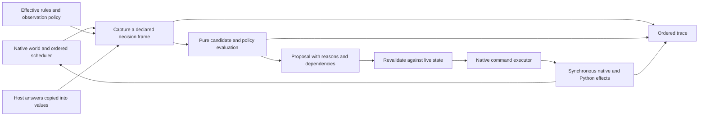

# Architecture critique and a practical route to simulation

**RoM has substantial game knowledge, but weak boundaries between observation,
decision and mutation. That is the main obstacle to stronger AI and trustworthy
simulation.** Adding more scoring rules or a large search algorithm before fixing
those boundaries will increase interactions that are difficult to explain and
test. Splitting large files alone would leave the underlying problem intact.

This is a source assessment, dated 11 October 2026, against GitLab revision
`1ab4f99a76adb530f86b278390ab8139ef41cc96`. The [existing correctness patch](../../fixes/README.md)
is discussed separately. The executable bodies used by the three new probes are
unchanged in patched revision `c5cb68778f4da58ecdd8ecd218a829da1e09cc2f`.
The bundled DLL is older than the source; no engine run or rebuilt DLL is claimed.

Read this alongside the [behavior guide](../../docs/review/AI_AND_GAME_LOGIC.md),
[algorithm study](../algorithms/README.md), and [simulation contracts](../../simulation/README.md).
The critique distinguishes three kinds of evidence:

* **Demonstrated contract:** an unchanged source fragment executed under an
  explicit adapter, or a directly inspected control-flow/data dependency.
* **Previously reproduced defect:** a documented incorrect result, with its
  [fix status](../../fixes/README.md) retained.
* **Architectural risk:** a plausible failure or integration cost requiring an
  engine scenario before claiming an actual gameplay defect.

## 1. Large decision routines encode an implicit priority system

The [structural audit](evidence.json) measures 220 directly contained native
`.cpp`, `.h` and `.inl` files, totaling 316,632 physical lines. This deliberately
excludes nested vendor directories; it is a narrower scope than the earlier
whole-tree inventory. Physical lines include comments and blanks. The following
counts are source measurements, not runtime profiles or cyclomatic complexity.

| Decision routine | Physical lines | Lexical return statements | Architectural consequence |
|---|---:|---:|---|
| `CvCityAI::AI_chooseProduction` | 2,715 | 155 | Priority depends heavily on which guarded branch commits first |
| `CvPlayerAI::AI_doDiplo` | 1,794 | 1 | Many contact/trade policies share one large traversal and mutation context |
| `CvCityAI::AI_buildingValueThreshold` | 1,766 | 4 | Many distinct economic effects feed one evaluator |
| `CvPlayerAI::AI_techValue` | 958 | 1 | Unlock values, costs, strategic evidence and randomness interact |
| `CvUnitAI::AI_attackMove` | 510 | 58 | Local action priority and fallback behavior are embedded in control flow |

[Production](https://gitlab.com/aretemaxxing-group/rise-of-mankind/-/blob/1ab4f99a76adb530f86b278390ab8139ef41cc96/Assets/CvGameCoreDLL/CvCityAI.cpp#L705)
is the clearest example. Its helper
[AI_chooseBuilding](https://gitlab.com/aretemaxxing-group/rise-of-mankind/-/blob/1ab4f99a76adb530f86b278390ab8139ef41cc96/Assets/CvGameCoreDLL/CvCityAI.cpp#L9782)
finds a candidate, may draw gameplay randomness, and immediately calls
`pushOrder`. It is an action, despite a name that could suggest a selection query.
Calling it while comparing hypothetical plans would change the live queue.

Early returns are useful for emergencies and cheap fallbacks. The problem is that
the priority hierarchy is spread across thousands of lines rather than expressed
as a reviewable policy. A later, highly scored alternative may never be evaluated.
A new condition inserted early can suppress several unrelated improvements.
Weight tuning cannot optimize choices that control flow never admits.

The class boundary also provides little isolation. `CvPlayerAI.cpp` has 25,147
physical lines and 1,461 lexical `GC.` accesses; `CvUnitAI.cpp` has 24,981 lines.
Those counts do not prove slowness, but they illustrate how much behavior reads
the world through global services. `CvPlayerAI : public CvPlayer` also makes
mutation available throughout the decision class.

**Recommended change:** retain a declared priority layer for forced/emergency
actions. Within each ordinary priority tier, generate proposals, evaluate them
against a captured decision state, and commit once. Initially preserve the exact
legacy branch order. Record which guard or earlier selection excluded an option.
Changing priorities is then a separate, measurable policy change.

## 2. Query-shaped interfaces have hidden effects

### A const getter can advance gameplay randomness

[AI_getStrategyRand](https://gitlab.com/aretemaxxing-group/rise-of-mankind/-/blob/1ab4f99a76adb530f86b278390ab8139ef41cc96/Assets/CvGameCoreDLL/CvPlayerAI.cpp#L20955)
is `const`, but lazily initializes a mutable field by calling
`getSorenRandNum`. Probe **A01** compiles that unchanged method with a counting RNG
adapter: the first cold query draws once; the next warm query draws zero times.
Inserting the cold query before another RNG request changes that request's place
in the stream.

This does **not** mean every call changes randomness, or prove an existing
multiplayer desynchronization. It means a debugger, explanation panel, shadow
planner or supposedly harmless observation cannot assume constness implies
behavioral purity. Strategy getters that reach this method inherit the concern.

**Recommended change:** make initialization an explicit scheduled operation;
give pure evaluation an already initialized value. First characterize and preserve
the existing draw order. Moving initialization earlier is a behavior change and
must be tested as one. For diagnostics, log values already computed by the live
decision instead of recomputing getters to explain it afterward.

### Path results belong to a global service, not the querying group

[generatePath](https://gitlab.com/aretemaxxing-group/rise-of-mankind/-/blob/1ab4f99a76adb530f86b278390ab8139ef41cc96/Assets/CvGameCoreDLL/CvSelectionGroup.cpp#L5375)
sets the querying group on `GC.getPathFinder()`. Its
[getPathLastNode](https://gitlab.com/aretemaxxing-group/rise-of-mankind/-/blob/1ab4f99a76adb530f86b278390ab8139ef41cc96/Assets/CvGameCoreDLL/CvSelectionGroup.cpp#L5312)
accessor retrieves the most recent node from that same shared pathfinder, without
passing group identity.

Probe **A02** executes those wrappers with a single-buffer host adapter. Group A
requests endpoint x=7, then group B requests x=11. A's later accessor sees x=11;
an immediate value copy from A's original result retains x=7. This demonstrates
the wrapper ownership/interleaving contract, not a discovered faulty sequence in
the live game or a reproduction of the host's search algorithm.

This API forces callers to obey an implicit rule: consume a result before a
different path query overwrites the shared context. Nested evaluation, candidate
comparison and parallel planning make that rule easy to violate.

**Recommended change:** wrap the existing host call and copy the needed result
immediately into a caller-owned value: success, arrival turn, residual movement,
end-turn plot, and any required path details. Do not retain `FAStarNode*` across
queries. Copy only what the consumer needs; copying an entire path costs `O(L)`
for length `L`. Keep calls on the existing game thread until thread safety is
demonstrated. Replacing A* is a separate project.

### Even legality queries can cross into Python

[canResearch](https://gitlab.com/aretemaxxing-group/rise-of-mankind/-/blob/1ab4f99a76adb530f86b278390ab8139ef41cc96/Assets/CvGameCoreDLL/CvPlayer.cpp#L8585)
conditionally calls Python when `USE_CAN_RESEARCH_CALLBACK` is enabled, and a
callback result can permit research before subsequent native checks. The native
signature does not establish that the callback is pure.

A headless implementation must honor configured callback semantics or explicitly
stop as unsupported. Copying only the XML prerequisite logic and calling that
“the legality service” would omit a real extension point.

## 3. Cache freshness and planning horizons are conflated

[AI_getStrategicContext](https://gitlab.com/aretemaxxing-group/rise-of-mankind/-/blob/1ab4f99a76adb530f86b278390ab8139ef41cc96/Assets/CvGameCoreDLL/CvPlayerAI.cpp#L4478)
aggregates useful empire evidence. This is a good performance improvement over
repeated city scans. Its validity predicate uses turn and player identity. The
cached data includes treasury runway, trade yields, war state, strategy flags
and population, all of which can change within a numeric turn.

There are two valid designs, but their contracts differ:

| Intended meaning | Correct behavior |
|---|---|
| Deliberately frozen planning frame | Every consumer knows the captured phase/epoch; live legality is checked before commit |
| Current-world query cache | Relevant world changes invalidate the result or change its key |

The current interface does not make that distinction clear. Some consumers use
the shared snapshot while also making live queries. `const Snapshot&` prevents
that caller from assigning fields; it does not make the mutable owner immutable.
This is a freshness/integration risk, not a demonstrated incorrect campaign
decision. Blindly refreshing on every mutation could also destroy intentional
strategic stability and restore expensive repeated scans.

The [operation delivery cache](https://gitlab.com/aretemaxxing-group/rise-of-mankind/-/blob/1ab4f99a76adb530f86b278390ab8139ef41cc96/Assets/CvGameCoreDLL/CvPlayerAI.cpp#L15410)
has a related contract gap. The outer key uses turn and source-city ID; entries
use operation ID and store reachability, travel time, present roles and incoming
roles. Group position/composition, incoming missions and access rights can change
within those keys. The routine does not put those dependencies in its cache key.
Whether a harmful stale result is reached requires a concrete call sequence.

**Recommended change:** name frozen frames explicitly and document their phase.
For live caches, start with a conservative decision/world revision and then split
into measured dependencies such as movement, diplomacy and membership epochs.
Test cold/warm queries and same-turn invalidation. Compatibility replay must
preserve the old cache behavior until a deliberate correction is enabled.

## 4. Rules and effects have multiple owners

Research is already a concrete warning. `AI_cachedTechPathLength` evaluates
prerequisites; `CvPlayer::findPathLength` estimates them again; `pushResearch`
constructs the queue with its own choices; `canResearch` enforces immediate
legality, including optional Python behavior. These methods answer different
questions, so collapsing them into one boolean would be wrong. However, they
lack a common explicit prerequisite model and plan-to-execution contract.

The [algorithm experiments](../algorithms/README.md#3-research-planning-the-highest-priority-algorithm-correction)
show why this matters: duplicated work and locally selected OR branches can
produce the wrong package cost. Fixing just the score can leave execution choosing
a different package. This research-planning problem remains open after the
previous correctness patch.

Building completion demonstrates the cross-language side:

```text
CvCity production completion
  -> setNumRealBuilding: native effects
  -> overflow / production-gold accounting
  -> CvEventReporter::buildingBuilt
     -> Python event bridge
        -> registered handlers, in order
           -> RoMEventManager may remove an older building or change gold
              -> native city/player mutations
     -> statistics update
  -> native completion continues
```

Sources: [completion](https://gitlab.com/aretemaxxing-group/rise-of-mankind/-/blob/1ab4f99a76adb530f86b278390ab8139ef41cc96/Assets/CvGameCoreDLL/CvCity.cpp#L13048),
[reporter](https://gitlab.com/aretemaxxing-group/rise-of-mankind/-/blob/1ab4f99a76adb530f86b278390ab8139ef41cc96/Assets/CvGameCoreDLL/CvEventReporter.cpp#L370),
[RoM handler](https://gitlab.com/aretemaxxing-group/rise-of-mankind/-/blob/1ab4f99a76adb530f86b278390ab8139ef41cc96/Assets/Python/RoMEventManager.py#L364).
The handler link targets the original revision, before the previously published
Python corrections.

Python is part of the rules engine. Treating it as UI glue would make a simulator
wrong on consequential transitions. XML is also only an input to the effective
rules: [module load order](https://gitlab.com/aretemaxxing-group/rise-of-mankind/-/blob/1ab4f99a76adb530f86b278390ab8139ef41cc96/Assets/CvGameCoreDLL/CvXMLLoadUtilitySetMod.cpp#L41),
defines, runtime IDs, options, native formulas and callbacks affect behavior.

Probe **A03** executes the unchanged ordinary
[BUG dispatcher](https://gitlab.com/aretemaxxing-group/rise-of-mankind/-/blob/1ab4f99a76adb530f86b278390ab8139ef41cc96/Assets/Python/BUG/BugEventManager.py#L357).
A controlled handler changes gold from 10 to 15 and raises; the dispatcher logs
the exception and runs a later handler, which doubles the value to 30. There is
no rollback. This is an explicit failure-isolation choice, but it permits partial
gameplay effects and makes logs part of diagnosing state consistency.

**Recommended change:** record ordered effects, nested callback spans and failures.
Keep synchronous ordering in compatibility mode. A blanket queued event bus or
transaction rollback would change semantics. Gradually give each rule an owner
and each command an effect contract. Start with one transition such as research
queue insertion or one building completion; do not port every Python rule at once.

## 5. Strategic memory was mistaken for disposable cache state

The earlier [agenda save finding](../../docs/review/DEEP_FINDINGS.md) showed why
state classification needs more rigor. A previous agenda and its review cadence
affect hysteresis; they cannot always be reconstructed from today's visible world.
Two identical economies with different plan histories can rationally choose
different next actions.

The published patch preserves that history in version-6 saves. It fixes a real
case, not the broader classification problem. The source mixes authoritative
world state, long-lived AI commitments, learned/reputation values, deliberately
stale planning evidence and expendable lookup caches in the same objects.

**Recommended change:** maintain a field inventory with owner, units, dependency
set, lifetime, save/checkpoint policy and invalidation triggers. A field is safely
discardable only if rebuilding it preserves the intended next decision, including
RNG effects and timing. A native legacy save/load transition and a lossless
simulator checkpoint must remain distinct operations.

Preserve full native entity IDs, owning player and native collection order.
The existing generation-aware free lists are useful infrastructure; replacing
their handles with dense simulator indices would introduce identity errors.

## 6. Feedback scores are not evidence of causal learning

[AI_updateLocalGovernor](https://gitlab.com/aretemaxxing-group/rise-of-mankind/-/blob/1ab4f99a76adb530f86b278390ab8139ef41cc96/Assets/CvGameCoreDLL/CvCityAI.cpp#L11031)
compares a prosperity measure at term boundaries, adjusts reputation, and retains
or replaces the governor. The
[policy](https://gitlab.com/aretemaxxing-group/rise-of-mankind/-/blob/1ab4f99a76adb530f86b278390ab8139ef41cc96/Assets/CvGameCoreDLL/AICityGovernorPolicy.h#L127)
uses population, plot yield potential, trade-route count, health, happiness,
connection, maintenance and danger. Plot potential includes city-assigned radius
plots, rather than just yields actually produced by worked plots.

This is a bounded feedback heuristic. It does not estimate what would have
happened under a different governor. Worker improvements, empire technologies,
war, city maturation and outside investments can change its reward. Dampening
disrupted periods helps but does not solve attribution. Governor recommendations
then affect agenda scores, creating a feedback path whose strategic value needs
measurement rather than inference from its names.

**Recommended change:** retain the heuristic as a baseline. Record exposure,
delivered outputs, costs and external changes. Compare alternative policies in
paired controlled scenarios before tuning on campaign outcomes. Keep proxy
metrics separate from victory probability. Feeding the same proxy into a genetic
algorithm could optimize the proxy's blind spots more effectively.

## 7. Tests and inactive code can overstate architectural confidence

The existing isolated suite is valuable, especially compiled policy tests,
overflow checks and targeted regressions. Some tests are lexical wiring checks:
for example, [layer contracts](https://gitlab.com/aretemaxxing-group/rise-of-mankind/-/blob/1ab4f99a76adb530f86b278390ab8139ef41cc96/Tools/test_ai_layer_contracts.py#L26)
check call positions and string presence. Those establish selected source
relationships; they do not establish that a runtime branch executes, candidates
are coherent, or an operation receives the correct reinforcements.

A concrete trap is
[AI_doCentralizedProduction](https://gitlab.com/aretemaxxing-group/rise-of-mankind/-/blob/1ab4f99a76adb530f86b278390ab8139ef41cc96/Assets/CvGameCoreDLL/CvPlayerAI.cpp#L1676):
it returns unconditionally before the wonder-planning body. Its presence and
caller do not establish an active centralized planner. Do not simply remove that
return to obtain coordination; the dormant logic needs its own evaluation.

The prior patched suite passed 15 isolated programs. That is useful evidence,
but it is not a full DLL build, Python 2.4 integration test, native save round
trip, or a campaign test. This turn adds three contract probes; it does not
expand those earlier claims.

**Recommended change:** keep evidence levels explicit. Add runtime branch traces,
small exact oracles, stateful legal command sequences, and matching rebuilt-engine
comparisons. Source/DLL/rules identity belongs in every result. Use text checks as
cheap guardrails, alongside behavior tests, rather than as the acceptance gate
for improved play.

## 8. Preserve the parts that make incremental improvement possible

The audit found **13 `AI*Policy.h` headers totaling 947 physical lines**, with no
lexical `GC.`, `gDLL->`, `GET_PLAYER(...)` or `GET_TEAM(...)` accesses after masking
comments and literals. That is a useful extraction pattern. It is not a proof
that every possible transitive dependency is pure, but these small interfaces
are much easier to exercise than the large native decision objects.

Also retain:

* Explicit military operation states and local recovery behavior. They provide
  useful continuity and legal fallbacks for better planners.
* Existing legality checks, mission execution, integer accounting, native IDs
  and turn-mode distinctions. Reuse them through controlled adapters.
* Shared strategic evidence where its lifetime is declared. Caching empire
  aggregates is often the correct optimization.
* The data-driven rules and Python extension points. Export their effective
  semantics instead of pretending that XML alone describes the game.

The legacy toolchain constrains implementation, not conceptual clarity. The
[Makefile](https://gitlab.com/aretemaxxing-group/rise-of-mankind/-/blob/1ab4f99a76adb530f86b278390ab8139ef41cc96/Assets/CvGameCoreDLL/Makefile#L2)
targets Visual C++ Toolkit 2003 with Boost 1.32/Python 2.4. Small structs, explicit
enums, functions, vectors and caller-owned scratch storage suffice. A wholesale
ECS rewrite, service framework, language migration or parallel engine would add
cost before resolving the observable defects. Keep the host ABI and save format
stable during pure extraction; use explicit versioned migrations when persistent
state actually changes.

## 9. The target boundaries and their ownership

This is a proposed incremental design, not an implementation already present.



| Boundary | Owns | Must not silently do |
|---|---|---|
| Effective rules | Resolved IDs, definitions, merge order, options and rule identity | Treat missing callbacks or base assets as zero-valued rules |
| Decision frame | Actor observation, capture phase, dependency versions, local candidates | Present frozen evidence as a current-world query |
| Policy module | Candidate values, ordering, explicit uncertainty and work budget | Mutate `Cv*`, execute Python, draw gameplay RNG, retain host path pointers |
| Proposal | Action, full target identities, assumptions, reason and fallback | Claim execution or reserve resources merely by existing |
| Executor | Commit-time legality, accepted ordering and actual effects | Reuse stale references or evaluate speculative alternatives during commit |
| AI memory | Agenda commitment, operation state, history and planning RNG state | Disappear as a supposedly reconstructible cache |
| Trace/checkpoint | Ordered observations, decisions, mutations and continuation identity | Recompute live getters to explain past choices |

A frame should carry source/rules identity, actor, phase, a decision sequence and
the relevant world revisions. A proposal should identify its planning frame and
list dependencies sufficient to revalidate it. Begin conservatively: rejecting
an unnecessarily stale proposal costs another decision, while executing an
invalid proposal can corrupt the experiment. Narrow invalidation only after tests
and profiling justify it.

Do not clone the entire empire for every unit. Capture shared immutable data once
per declared planning interval, attach small per-decision observations, and use
bounded scratch buffers. Generate the legal candidate set outside the solver's
inner loop. An `O(n^3)` assignment solver is irrelevant to total cost if obtaining
its `n^2` path costs repeatedly dominates the turn.

A synchronized decision needs deterministic candidate order and work quotas.
Use elapsed time for profiling, not machine-dependent stopping conditions.
Offline scenario execution can run across independent processes; that does not
establish that the native pathfinder, Python or world globals are thread-safe.

## 10. A staged implementation sequence with acceptance gates

| Stage | Concrete change | Required evidence before moving on |
|---|---|---|
| 1. Observe safely | Trace existing branch results, RNG requests and callback nesting at the point they occur; add a path-result value adapter | Logging on/off preserves decisions and RNG; interleaved path calls cannot overwrite returned values |
| 2. Extract one decision | Typed policy runner plus research graph normalization and proposal generation | Production policy bodies run under ordinary/boundary fixtures; unknown capabilities return `Unsupported` |
| 3. Integrate research | One explicit legal package/order shared by evaluation and queue execution | Exhaustive small-graph oracle, horizon/partial-progress/team cases, queue callbacks and trade invalidation |
| 4. Coordinate one task domain | Regional single-worker assignment with task reservations, idle choices and explicit path inputs | Better objective at equal total path budget; ties, invalidated targets and scarce capacity handled |
| 5. Extract economic choices | Preserve production priority tiers; pure city/civic candidates and one commit point | Baseline branch parity first, then separate policy comparisons; treasury and delivery costs reconcile |
| 6. Extend simulation | Sequential one-city transition, then missions/combat with recorded host answers | Ordered native/Python effects and checkpoint restore match a recorded supported scenario |
| 7. Evaluate stronger policies | Bounded tactical search and offline parameter learning | Matching rebuilt-engine slices, held-out scenarios, failure rates and turn-time distributions |

These are dependency gates, not duration estimates. Engine instrumentation and a
reproducible Windows DLL build should progress early; they are prerequisites for
claims about native behavior, not prerequisites for isolated policy work.

Every extraction needs two separate comparisons:

1. **Behavior preservation:** same inputs, legal outcomes, RNG calls, callback
   order and tie rules. A shadow run must consume captured values and its own
   planning state; calling the old impure evaluator again is not safe shadowing.
2. **Policy improvement:** intentionally different choices evaluated on an
   explicit objective and held-out scenarios. A refactor's passing equivalence
   test does not show a stronger AI; a higher model score does not show parity.

Keep the existing action path as a fallback until the extracted policy's scope
is supported. An exhausted search budget returns a feasible incumbent or an
explicit failure state; it does not prove that no legal action exists.

The architecture should make the next decision inspectable without changing it,
make hypothetical choices safe to compare, and make accepted effects traceable.
Those are more valuable near-term improvements than another layer of strategic
weights with hidden execution dependencies.

## Reproduce the evidence

```sh
python3 research/architecture/audit.py /path/to/rise-of-mankind
# If the earlier local source-fix commit is present:
python3 research/architecture/audit.py /path/to/rise-of-mankind --compare-ref c5cb687
```

Requirements: Python 3, Git and `g++` with C++03/UBSan support. No new dependencies
or services are needed. The script reads pinned Git objects, leaves the source
checkout untouched, and records file/fragment hashes and compiler flags in
[evidence.json](evidence.json). A comparison revision may change other measured
methods—global rollover was deliberately fixed—while the executed probe bodies
must remain identical for the comparison assertion to pass.

All three probes passed. They use two compiled C++ source harnesses and one
unchanged Python dispatcher body with documented adapters. Their limits are
recorded individually. GCC success is not Visual C++ 2003 ABI validation, and the
host stub does not implement A*. The large-routine measurements include comments
and conditionally compiled source; they establish review scale and lexical
structure, not runtime hotness or complete test coverage.
