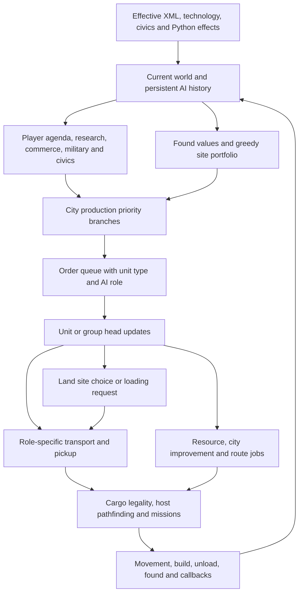

# Carthage autoplay: decisions, defects and the next simulation slice

Follow-up: [opening development and the settler voyage dispatcher](../transport/README.md)
targets newer GitLab `19e4d59`, which incorporates this report's runtime fixes.
This report retains its original source and observation provenance.

The reports expose a coordination problem: producing useful pieces does not
ensure that they form a useful sequence. The current source also contains
reproducible local bugs. This review fixes those bugs and defines the experiments
needed before replacing the larger policies.

The user identifies the run as **Carthage under AI autoplay**, using a DLL compiled
locally on **2026-10-11 from the latest GitLab commit**. Both remotes were fetched:
GitLab remained at `5e6d035`; GitHub was at `9c6f297` before this publication.
The older bundled DLL is therefore not the explanation for this reported run.
The locally compiled DLL's hash is unavailable, so exact binary identity is still
unverified. [Save metadata](save-metadata.json) records the supplied save's hash,
447,908-byte size, turn 241, scenario and 53 module entries. The outer save version
302 is distinct from the mod's AI extension version 6. No city/unit state was
decoded and no BTS replay was performed. The raw save is not published here.

The [latest patch and checks](../../fixes/README.md#carthage-autoplay-coordination)
target that GitLab revision and include the earlier tested cleanup. Fixed source
retains the contributor's operation-supply, reserve and general-career changes.

## What the complaints establish

| Observation | Source evidence and assessment | Outcome of this pass |
|---|---|---|
| Camp remains on Copper | Camp does not connect Copper; Mine does. Copper is revealed by Metal Casting, city trade requires Mining, and BUILD_MINE requires Mining. Safe automation survives autoplay and blocks replacement in the resource worker selector, despite a resource exception in city planning/build execution. | Fixed that contradictory selector gate. Whether safe automation was enabled in this save remains unknown. |
| Workers choose questionable improvements | The resource selector minimizes `10000 / (buildTime + 1)`, favoring slower builds. The city planner already has a hard resource-connection override. | Fixed inverse ordering; retained legal-build, forest and existing-connection guards. This is not a new yield optimizer. |
| Escort and settler fail to travel together | Four-slot galley; CITY_DEFENSE loading gates require at most one free slot. A lone settler leaves three free slots, so these escort paths reject it. The ship's pickup request merely waits for units to load themselves. | Fixed the two early escort gates and verified the departure condition. This is a concrete related failure, not proof of the exact reported escort-only sequence. |
| Settler before escort | The early expansion branch immediately queues a settler; the earlier escort branch reacts to an already-existing settler. There is no future escort arrival reservation. Another later branch queues a defender after choosing a settler; queue insertion semantics matter. | Planning gap remains. A universal escort-first rule would also delay expansion when another city's escort is already coming. |
| Many unused galleys | ASSAULT_SEA, SETTLER_SEA and other roles have different loading and movement routines. Several production paths derive hull demand from army/coastal-city counts without a named voyage. | Strong architectural concern; no verified count or role inventory from this save. Duplicate supply accounting fixed, but it suppresses production and does not explain excessive hulls. |
| Pastoral wastes anarchy without pastures | Pastoral removes Hunter-Gatherer's -25% worker-speed and military-production modifiers, improves trade-yield modifier from -50 to -30, adds low upkeep and pasture yields. | The switch can be rational without a pasture. Its timing is still unproven; no blanket civic veto added. |
| Safety delays the workboat | Current code already prioritizes workboats after one physical defender, subject to danger, turtle strategy, escort needs and earlier special cases. Local resource demand is compared with water-area-wide boat supply. | Need the decisive branch, availability and travel time of existing boats, and an economic comparison. No arbitrary safety reduction added. |
| Settlement locations look poor | Spatial scoring, greedy site selection, affordability, production and delivery are separate decisions. There is no joint build-and-delivery rollout. | Define paired site/sequence experiments below; do not train on the AI's own choice as truth. |

The new tests also expose a separate settler safety error: after deciding to skip
because of danger, `AI_settleMove` continued into later actions. It now returns.

## How the decisions connect today



This is not a single planner. `AI_chooseProduction` is a long ordered cascade:
an early successful helper can queue an order and return before later economic
alternatives are considered. Lowering the final military probability does not
affect those earlier branches. `AI_bestUnitAI` selects a trainable civilization
unit for the requested role; the generic role selector first computes deficits,
then applies role weights and randomness. Unit type alone does not identify the
decision that created it.

`AI_totalUnitAIs` already adds active and queued units. Its area and water-area
counterparts also include production, with the latter adding ships and queues in
ports. Extra queue terms therefore counted the same commitment twice. Explorer
logic additionally charged all other land areas' queues against a local need.
The fixes remove the duplicate terms instead of adding another compensating
weight. Existing lexical tests had required those extra calls; numerical tests
now execute the aggregate methods and consumers.

Worker behavior has two partly independent planners. `AI_improveBonus` scans
owned reachable resources before much city work. City `AI_bestPlotBuild` caches
the preferred job for a workable tile; unit routines then decide whether to take
it. A city-side resource override cannot cure an earlier unit-side refusal. The
new resource gate follows the build executor's existing exception and still
requires a legal connecting build. It does not reveal hidden resources, replace
an existing connecting improvement, or ignore the leave-forests option. The
current base Mine build does not itself remove a feature.

Settlers usually lead their mixed groups (`AI_groupFirstVal` gives SETTLE the
highest listed priority). Loading calls may split groups, and loading itself can
ungroup units. Ships inspect actual cargo roles; `AI_pickup` marks a waiting or
travel mission rather than directly boarding a chosen passenger. `AI_load`
independently searches compatible transports and subtracts incoming loading
missions from capacity. These are several opportunities for an intended party
to lose its association. An escort without a settler is normally unloaded by a
settler transport in a friendly city; that recovery can obscure the earlier
failure. Trace boarding, splitting and unloading, not just the final screenshot.

The corrected CITY_DEFENSE path accepts a ship already holding a settler with
spare capacity and no CITY_DEFENSE cargo. A partly full ship can then enter
`AI_settlerSeaTransport` when that defender is aboard and no other loading
missions target it. Actual departure still needs movable cargo, a suitable site
and a path within the expansion horizon. The test verifies the cargo and dispatch
gates; it supplies no evidence about an engine path.

## Where the current architecture is weak

**Proxy demand substitutes for a job.** “Several mobile land units near coastal
cities” is a capacity estimate, not a reason to build another assault transport.
The explicit and generic production paths also use different transport-demand
formulas. A transport should have an attributable demand: destination, payload,
departure window and feasible route. A small strategic reserve can be explicit,
but idle hulls should count against it.

**Supply is counted without enough location or time.** One workboat somewhere on
the sea does not mean this city's fish will be improved before another boat could
be built. Conversely, one queued scout is already supply; charging it twice is
incorrect. Required distinctions are active, queued, reserved, deliverable and
delivered, with scope and estimated arrival. Derived counts should come from one
ledger so city order cannot create duplicate commitments.

**A score is treated as an economic rate.** `AI_doCivics` applies a horizon and
anarchy threshold to package scores. `AI_civicValue` contains heuristic constants,
city-count proxies and assumed improvements (`existing + cityCount / 2`), not an
actual simulation of worked yields and foregone city output. No-pasture Pastoral
is not automatically wrong, but a utility gain does not by itself prove that one
turn of real empire-wide anarchy is repaid. Package interactions are also not
fully represented by selecting each civic category independently.

**Site quality does not imply timely value.** `AI_foundValue` considers yields,
resources, overlap, coast, bad tiles and distance, then `AI_updateCitySites`
greedily chooses sites and recalculates nearby overlap. The added coastal premium
is bounded but does not require a funded workboat/harbor plan. Current site
ranking deliberately excludes cash-flow affordability, while later gates apply
empire-wide caution. The missing piece is a site-specific rollout including
maintenance, delivery and improvement timing. An upstream comment in
`AI_getMinFoundValue` still says site-specific affordability lives in
`AI_foundValue`; the implementation contradicts it. The patch corrects that comment.

**Production ordering hides alternatives.** The workboat-first foundation exists,
but a preempting branch prevents its evaluation. Another arbitrary early return
will move this problem around. Preserve urgent defense as a constraint and compare
short economic sequences among the remaining legal alternatives.

## A bounded operation model for the next implementation

Represent a civilian expedition as one operation with stable native IDs:

```text
operation: owner, destination, source city, desired founding window
payload: settler, required escort, optional worker
delivery: land route OR embark port + transport + landing route
commitments: existing unit OR production order, expected ready/arrival turn
status: candidate -> assembling -> ready -> moving -> founding -> complete
recovery: assembling/moving -> blocked -> replan or release
```

The following invariants matter more than a sophisticated optimizer:

1. Each unit, production order and cargo slot has at most one active reservation.
2. An unavailable escort is a missing prerequisite, not a reason to keep adding
   unrelated troops. Protect city garrison requirements before assigning it.
3. A ship/settler pair retains its association through boarding and group splits.
4. An assembled party may depart with empty optional slots. Additional workers
   must not hold the critical settler/escort pair indefinitely.
5. Every blocked operation records a reason and retry condition. Invalid sites,
   dead units, changed diplomacy and stale paths release or replace commitments.
6. Supply derives from commitments exactly once; execution rechecks legality.

Initially derive this ledger from native units, missions and queues each planning
pass. That avoids a second persisted truth and a save-format change. If persistent
intent proves necessary, add a versioned record with explicit load migration;
never label continuation-affecting state a disposable cache.

Use C++03 structs, enum states and `std::vector` records with stable integer IDs.
Cache path results only under movement, membership, access and map dependencies.
No new per-unit whole-map search is needed for a small candidate set. For `U`
units, `Q` queued orders and `E` eligible assignment edges, ledger construction
can be `O(U + Q)`, with sorted greedy assignment `O(E log E)` and bounded local
reassignment. Hungarian assignment fits one-to-one subproblems; capacity and
multi-unit party constraints require a richer formulation and do not inherit
Hungarian optimality. Real path queries will often dominate all these costs.

For opening production, enumerate a small shortlist of legal two- or three-step
sequences, including workboat/defender/worker/settler alternatives, and simulate
food, citizens, yields, production, upkeep and completion times over a declared
horizon. Prune sequences that miss a defensible threat deadline. A bounded beam
of 8–16 states and 4–8 candidates is a starting experiment, not a certified optimum.
Spend deterministic work quotas; use a separate planning RNG if sampling is
needed. Genetic algorithms remain appropriate for offline parameter tuning after
the transition model is validated, not for correcting a reversed comparison.

## Experiments that answer these reports

| Scenario | Required comparison | Acceptance evidence |
|---|---|---|
| Copper camp | Revealed/hidden Copper; Mining legal/illegal; safe automation on/off; connected fort/mine controls | Legal connector selected and completed, then bonus network becomes usable; no omniscient reveal |
| Worker alternatives | Legal builds with different times, progress, features and yields | Base-time selector regression now covered; later optimizer compares actual completion/value |
| Maritime party | Capacities 2/4/6; settler first, escort first, worker first; multiple ships; both unit-update orders | One reserved party boards its assigned ship and reaches a legal destination, or records a specific blocker |
| Escort timing | Escort absent, existing locally, incoming from another city, or needed as garrison | Compare founding date and growth while preserving survival constraints; do not assume escort-first always wins |
| Idle fleet | Same force with reachable mission, no mission, blocked route and changed diplomacy | Attribute every new hull to a voyage or explicit reserve; measure empty/loaded turns and delivered units |
| Workboat opening | Workboat first versus javelineer first, under calm and genuine nearby threats | First improved/worked resource turn, population, hammers, beakers, unit readiness and losses at matched horizons |
| Pastoral timing | Stay, switch now, switch after boat, switch with another civic; zero/existing/planned pastures | Actual anarchy and upkeep, trade rounding, improvement completion, production and research—not civic score alone |
| Settlement | Same start/RNG state, alternative site plus feasible worker/escort/boat schedule | 25/50-turn empire-wide net output, maintenance, survival, expansion and denied enemy options |
| Commitments | Multiple cities choose in opposite orders, including separate islands | Each queued unit counted once; no two cities satisfy the same reserved job |

The existing SettlementModel tooling already supports grouped runs and controlled
pairwise labels. Reuse it for settlement experiments. An unbranched successful
city is not evidence that the rejected site would have been worse. Match source,
effective rules and initial RNG state; changing decisions can change subsequent
gameplay draws, so document divergence and use paired multi-seed runs for outcome
claims. Do not force the engine to consume invented compensating draws.

## Trace before full simulation

The next engine capture should record the existing decision's intermediates,
without calling scorers again for logging:

* Build/DLL hash, effective XML/module identities, scenario, player, turn/phase,
  native IDs, autoplay state and automation options.
* Production branch identifier, danger/turtle/war gates, local resource jobs,
  active/queued/reserved counts, order contents before/after, and role selected.
* Worker bonus visibility, old improvement, legal builds and rejections, selected
  build, path result, progress, and resource-network connection after completion.
* Boarding initiator and group members, transport role/capacity, incoming loading
  missions, actual cargo IDs, split/unload events and departure refusal reason.
* Civic current/candidate values and components, actual anarchy length, current
  improvements and worked plots, upkeep and trade calculations.
* Settlement shortlist, score components, affordability, chosen delivery and
  first divergence from the comparison branch.

Start headless work with this **one civilian-expedition slice**, using recorded
host path answers keyed to their full inputs. Stop explicitly at unsupported
engine services. Then add the economic opening slice. A path stub returning true
or a synthetic yield table cannot support a claim that Carthage is fixed in-game.

## Validation and references

Eight new tests execute source fragments and base XML facts. Seven reject GitLab
`5e6d035`; the XML control passes. Updated source passes all 17 isolated regression
programs. The tests use C++03, warnings as errors and fatal UBSan. They do not
compile the full DLL or replay the save. The patch changes neither game balance
XML nor serialization.

[Source links](source-links.json) pin every main routine above to the reviewed
GitLab revision. See also the [architecture critique](../architecture/README.md),
[algorithm study](../algorithms/README.md), [turn/AI guide](../../docs/review/AI_AND_GAME_LOGIC.md)
and [simulation contract](../../simulation/README.md).
