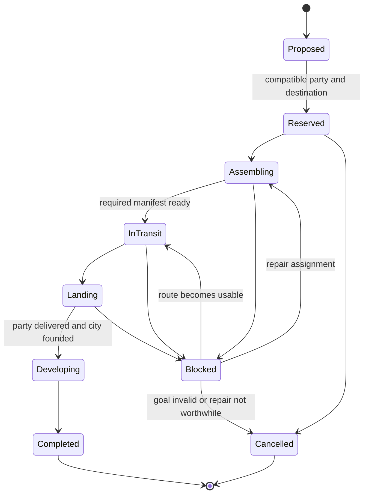

# C++ integration specification

Implementation progress: the [first economic arithmetic slice](../../simulation/economy/README.md) is executable and source-fragment checked. Full native effects/export and policy integration remain pending. The [landing handoff correction](../landing/README.md) separately fixes a concrete execution boundary in current GitLab source.

These interfaces and milestones are proposed. The executable artifact in this directory is the independent scheduling lab. No planner described here has silently been installed in the DLL.

## 1. Integrate around existing decision points

| Native boundary | First change | Preserve |
|---|---|---|
| `CvPlayerAI::AI_getStrategicContext` | Typed counts distinguish active, queued and assigned assets; attach evidence revisions | Existing turn orchestration and native ownership |
| `CvCityAI::AI_chooseProduction` | Extract non-mutating proposals for continuing production, worker/workboat jobs, required recruitment and useful buildings | Legality and genuine immediate interrupts; one final `pushOrder` |
| `CvCityAI::AI_assignWorkingPlots` | Capture current assignments and expose a pure one-turn allocation/economic evaluator | Food consumption, specialists, modifiers and actual population |
| `CvPlayerAI::AI_doCivics` | Compare current, immediate-switch and deferred-switch packages within economic plans | Joint legality, timers, anarchy and revolution callbacks |
| `CvUnitAI::AI_improveBonus` / worker movement | Generate worker jobs with travel/work/connection dates and partial progress | Native build legality, safe automation rules and movement execution |
| `CvPlayerAI::AI_updateFoundValues`, `CvUnitAI::AI_found` | Attach development forecasts to independent candidate/route plans | Patch 0007's complete candidate snapshot and actual mission reservations |
| `CvUnitAI::AI_update`, loaded transport controller | Consult one expedition owner before role dispatch; reconcile actual cargo | Native path/boarding/landing legality and immediate emergency handling |
| `AI_updateMilitaryOperations`, team war planning | Compare a small set of operational methods and delivery schedules | Existing phases, capturers, supply, retreat and diplomacy constraints |

Do not place a second mutating empire controller ahead of the old one and hope their decisions agree. Migrate one decision domain at a time: legacy proposal → pure comparison → one authoritative commit.

Player economics and unit updates occupy different native phases. `CvPlayer::doTurn` calls pre-turn AI before city economics; `doTurnUnits` has its own pre-unit updates. Different turn modes have different activation/deactivation ordering. Export and validate the actual boundary; a generic `for player: takeTurn()` is not enough.

## 2. Small data structures with explicit contracts

Use C++03-compatible value types, deterministic arrays/vectors and index-based arenas. The following is interface pseudocode, not compilable shipped code:

```cpp
struct EvidenceVersion {
    int turn, phase, player;
    unsigned int units, cities, map, diplomacy, rules;
};
struct DecisionSnapshot {
    EvidenceVersion version;
    // Contiguous city, plot, unit and rule records. No live game pointers.
};
struct ResourceReservation {
    int resourceKind, owner, nativeId, startTurn, endTurn, amount;
};
struct ProposedTask {
    int id, method, target, prerequisiteBegin, prerequisiteCount;
    int reservationBegin, reservationCount;
    int earliestStart, estimatedFinish;
};
struct PlanResult {
    enum Status { Exact, FeasibleLimited, NoPlanWithinBudget,
                  InfeasibleProven, Unsupported } status;
    // Target-width signed wide values; lower/upper bounds have validity flags.
    int nextAction, incumbentPlan, nodes, pathQueries, forecastSteps;
};
```

Use the project's native wide-integer typedef/`__int64` where required by its Windows compiler; Linux `long` is not a portable replacement for a Windows-target type. The lab's `long long` compilation checks arithmetic, not the DLL ABI or Visual C++ compatibility of an entire translation unit.

Keep scores in documented units. Exact bounds must bound the same objective as the incumbent. A learned value estimate, weighted sum of heuristic scores or beam priority is not automatically an upper bound. Keep feasibility separate from preference: an illegal mine, inaccessible coast or unavailable ship cannot become feasible by receiving a sufficiently large score.

Snapshot construction must not consume gameplay RNG, push queues, change roles, speculate through `revolution`, or invoke mutating Python callbacks. Existing `const` getters are not evidence of purity. Capture already computed strategic randomness; copy shared path results immediately. Shadow planning uses a separate deterministic experiment RNG and cannot perturb live observations or decisions.

## 3. Economic forecast and scheduling

Start with one city and one worker/water improvement. Validate these transitions before expanding scope:

1. Current worked plots/specialists and center output, including food/production/commerce modifiers.
2. Food stock, growth/starvation, happiness/health and caps; workers/settlers that use food production.
3. Production progress, remaining cost, overflow, completion and queue changes.
4. Worker travel, effective work rate, required technology, ownership/culture access and improvement completion.
5. Resource connection versus tile yield; trade, unit upkeep and city maintenance.
6. Anarchy, civic modifiers and timed changes; declared callback effects or an explicit unsupported result.

Clone only compact state records needed by this slice. Share immutable effective rules and map topology. Model completions as events to skip uninteresting intervals, **but retain all intervening stock/rate and rule changes**. Waiting is legal: never import the StarCraft paper's goal-specific earliest-start simplification as a proof that waiting is always dominated in RoM.

Candidate methods should include missing prerequisites. A workboat whose resource is outside current culture needs a dated access plan; a mine requiring future technology needs that research package. Conversely, do not speculate that an unknown technology or absent worker is available at a generic readiness percentage.

Use a small beam as the first general package selector and an exact solver on tiny cases as an oracle. Seed a feasible incumbent, compare multiple package orders, preserve legal partially completed work and return a valid first action when the budget ends. If the beam loses all feasible plans but its baseline remains feasible, retain the baseline. If neither is feasible, report `NoPlanWithinBudget`, not a proof that expansion or defense is impossible.

A short horizon needs a terminal value for remaining useful production, population, resource access and technology progress. Fit/validate it against longer controlled branches; do not reward unfinished projects solely because the search started them. Use multiple planning horizons as an ablation and inspect end-of-horizon procrastination.

Production and research are coupled but do not need a whole-game joint tree immediately. Generate a small set of technology packages requested by concrete economic/military methods, estimate their completion windows, and iterate the economic schedule with those windows. Report approximation when team research, trade or opponent reactions invalidate fixed costs.

## 4. Expedition and operation ownership

A proposed job lifecycle is:



Walking can bypass assembly/landing phases. `Blocked` has a specific reason, expected release condition and next review date. Waiting for movement refresh differs from waiting for a nonexistent escort. Leases are based on expected progress and evidence, not an arbitrary turn count that cancels a legitimate long voyage.

Invariants:

- A unit or required capacity slot has at most one authoritative reservation for an overlapping time interval.
- The party fits one represented transport plan; escorts cannot satisfy two simultaneous manifests.
- A required guard is not reassigned while its defense commitment remains binding.
- A target belongs to the job; a role change or selection-group replacement does not erase it.
- A transport's cargo and passenger references agree after boarding, manual intervention, death, capture or loading a save.
- An update either advances the job or records a concrete blocker. Generic exploration/pickup cannot replace an owned job silently.
- Cancellation releases only that job's claims. Feasibility is rechecked at commit and before each irreversible primitive action.

Native object IDs must include the owner's namespace and the engine's full ID semantics. Do not persist container indices or raw pointers. A selection group can be replaced during a role change; use stable unit identity and reconcile the group. Added persistent jobs need an explicit save-version/migration plan or a proven deterministic reconstruction path. Patch 0007 added no such save state; this proposed executor must not pretend otherwise.

The bundle selector first partitions local independent conflict components. Within a component, solve small compatible sets exactly; larger components use a deterministic node budget, an incumbent and a valid positive-value relaxation bound where available. Time-expanded slots or interval checks prevent serial reuse from being mistaken for simultaneous capacity. A bipartite reduction is allowed only when the remaining compatibility constraints really are separable.

## 5. Runtime budgets and cache correctness

Avoid whole-world rollout on every unit update. Refresh proposals at decision events, revalidate commitments cheaply, and batch regional assignment. Measure native path calls, candidates, transition steps, allocations and callback costs separately. OpenRA's inspected scheduler is an example of spreading ownership updates; RoM must adapt the principle to deterministic turns rather than copy tick behavior.

Initial experiments can compare beam widths 8/32/128 and short/medium horizons, but those are experimental settings, not production budgets justified by the lab. Choose limits from matching Windows DLL profiles across early and late games. Multiplayer action choices must use deterministic operation counts, not wall-clock timeouts that can choose different moves on different machines. Use elapsed time for measurement.

For patch 0007, preserve a valid incumbent when adding a path-query budget. Track the best remaining upper bound and resume or report the gap if the snapshot still matches. Never return `NO_REACHABLE_SITE` merely because a query budget ended. Once city rollout changes the utility scale, retire the raw-found-value bound unless a new admissible bound is proved.

Cache keys need movement profile/group composition, remaining moves, route flags, endpoints and relevant map/access/diplomacy/observation revisions. A turn number alone cannot validate a path after a within-turn border change or cargo rearrangement. Cache unsupported/negative results with the same discipline. Do not parallelize calls into the shared native pathfinder or mutable game globals.

## 6. Acceptance gates and implementation order

1. **Economic adapter PR:** pure snapshot, one-city transition and native trace exporter; compare stocks/rates/completion order on matching builds. No policy change until the accounting slice is credible.
2. **Economic choice PR:** propose/score/commit for workboat, worker and required recruitment; retain legacy fallback and publish cases where each alternative wins. Add civic switching only once anarchy/upkeep are in the model.
3. **Expedition PR:** ownership, compatible bundle selection, actual-goal fleet demand and liveness tracing; adversarial update permutations and native harbor scenarios.
4. **Allocation PR:** region-level worker jobs and prerequisite package execution integrated with accepted plans.
5. **Opportunity PR:** operation portfolio, threat scenarios, scouting value and tactical search over a verified combat slice.
6. **Training/ablation PR:** learn small terminal/ranking models, compare beam/RHEA where appropriate, and remove systems that fail held-out value and runtime tests.

This plan calls for implementation, not an indefinite documentation phase. Each PR must ship a narrow functioning slice, an executable regression and an outcome comparison. The missing engine adapter is real work; feeding guessed defaults into it would make every later optimization result unreliable.
