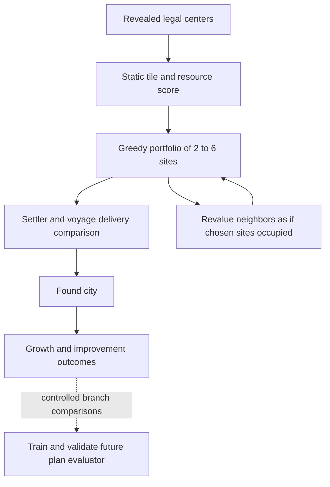

# Settlement placement: findings, corrections and the next optimizer

**Implemented follow-up:** [Joint destination and route search](../settlement-search/README.md)
removes premature portfolio pruning and land-first ferry selection. This report
records the preceding investigation.

Reviewed GitLab base: `19e4d59e0a8fc5dc138de5108d8e921e95d28ba1`, with the opening
and voyage changes from local source `a9003cae719e69456e698905d44a28a4f508199a`.
Publication targets newer GitLab `6222511`, which incorporates those voyage runtime changes.
Both remotes were checked. This is source analysis and executed fragment testing;
no claim is made to have decoded settlement decisions from the uploaded save.

[Tested source patch and application instructions](../../fixes/README.md#settlement-placement).
The [manifest](../../fixes/settlement-manifest.json) records the exact tested tree;
[before](../../fixes/settlement-before.log) and [after](../../fixes/settlement-regression.log)
logs distinguish reproduced failures from the corrected behavior.

## Assessment

The present AI does not optimize the development of a new city. It combines
static tile values, geography bonuses, hard vetoes and sequential multipliers,
then gives a small, spatially separated shortlist to units that have additional
founding shortcuts. There is useful domain knowledge here, but no consistent
objective shared by the scorer, portfolio builder and settler executor.

A better objective is the expected **marginal contribution to the empire** over
several horizons, including the opportunity cost of the settler, improvements,
transport and maintenance. A city with ten attractive future tiles may lose to
one with two excellent tiles it can immediately work. Conversely, travel delay
can be worth paying for a site that secures a scarce resource or strategic port.
Neither “always settle close” nor “always claim maximum resources” is adequate.

The previous transport change cannot repair a valuable destination discarded
before route evaluation. Settlement and delivery must ultimately share a plan.

## What actually happens

| Stage | Source | Behavior and consequence |
|---|---|---|
| Refresh | `CvPlayerAI::AI_updateFoundValues` | Scores revealed centers, updates area maxima, clears and rebuilds candidate sites. |
| Local score | `AI_foundValue` | Approximately 1,000 lines: legality, area gates, radius overlap, nature/current yields, bonus-improvement guesses, food adjustment, geography and distance modifiers. |
| Shortlist | `AI_updateCitySites` | Greedily takes 2–6 sites; multiplies by area opportunity, recalculates neighboring scores and treats hypothetical sites as occupied. |
| Dispatch | `CvUnitAI::AI_settleMove`, `AI_found` | Checks danger, geography and cargo; walks or ferries to a shortlisted site using delivery-discounted value. Existing on-site shortlist and first-city founding cases remain. |
| Execution | `CvCity::init`, `CvPlot::updatePlotGroupBonus` | Creates the city, removes the improvement/features as applicable, updates routes and bonus connections. |
| Measurement | `SettlementTrainingProfiler` and `Tools/SettlementModel` | Already provide opt-in candidate/tile/outcome logs and a pairwise training workflow. Reuse these rather than creating another data pipeline. |

## Corrections implemented in this pass

1. **Sea resources were excluded from the main resource calculation.** Its area
   test admitted the city's land area or an area already containing our cities.
   Normal water areas have no land cities. Fish could contribute raw water-tile
   value and a later coastal multiplier while missing the main bonus value,
   improved food and food-surplus calculations. Coastal water bonuses now enter
   that calculation. Inland and uncolonized foreign-island controls remain.
2. **Improvement base yields were omitted from the resource projection.** It
   included nature and bonus-specific yields, but not the improvement's ordinary
   yield. This loses the mine's +1 production in the checked XML. All three
   projected yield channels now include the base improvement yield.
3. **The entire city was penalized for containing additional resources.** More
   than two distinct bonuses or more than four total bonuses triggered a divisor
   on all value. For example, a 3,000-point subtotal could become 2,583 after
   adding 100 points and a third distinct resource: `3100 * 5 / 6`. Removed this
   count-based whole-city discount. Existing per-resource diminishing returns
   remain: first missing bonus versus duplicate bonuses receive different value.
4. **Compact legal cities were penalized twice.** Shared city-radius tiles are
   already excluded from the score, yet distance two also subtracts 4,000 and
   distance three subtracts 2,000. The mod's `MIN_CITY_RANGE` is 1. Removed this
   fixed close-spacing subtraction; legality, overlap, distance scaling and the
   other existing terms remain. This is a deliberate heuristic correction, not
   proof that dense settlement is always best.
5. **The core-proximity bonus used the wrong distance.** The code computed
   `iDistanceToCapital`, then used distance to the nearest city instead. A site
   near a peripheral city received an undeserved core bonus. It now uses the
   capital distance, with a protected denominator.
6. **Queued settlers were counted twice in portfolio demand.** `AI_totalUnitAIs`
   already includes training. The portfolio now receives active units and queued
   units separately, preserving its current 2–6 bound.
7. **A local peak could override the larger placement decision.** A settler could
   immediately found if its current tile beat eight adjacent tiles and there
   was some positive area candidate elsewhere. That did not require the current
   tile to beat the shortlisted destination after travel cost. Removed this
   shortcut; the normal shortlist/delivery comparison handles that choice.

These changes add no per-plot search loop, path query, XML rule, RNG consumption
or save field. They remove more runtime lines than they add. They intentionally
retain the existing heuristic architecture while correcting its demonstrated
inconsistencies.

## Criticism that still applies

**Population and time are inadequately represented.** The scorer adds values
across the radius. Ring-one tiles get a multiplier, and food surplus gets a
modifier, but it does not execute a growth schedule or reserve the workers/work
boats needed to realize that food. Future improved resources and immediate
income are not distinguished by a coherent completion time. The selected bonus
improvement is the first `BonusMakesValid` entry in XML, not the best feasible
build schedule. Technology, feature removal, production and labor availability
must become inputs to the development plan, rather than new arbitrary bonuses.

**Overlap is treated as exclusion instead of allocation.** An existing city
radius makes a tile contribute no direct tile value to the new site, even when
nobody works it. This discards the practical benefit of sharing strong food
between young cities. For hypothetical shortlist sites, more than one shared
radius tile can reject a candidate altogether through `iTeammateTakenTiles`,
although that variable is actually being incremented for our own planned sites.
A proposed city is not yet an occupied city. Alternatives should not reserve
land until a party accepts a job.

**Candidate pruning can prevent any downstream optimizer from winning.** Only
2–6 globally selected sites survive. Selection occurs before individual travel
costs, and the area opportunity factor can still approach 3x. A good nearby
runner-up or a useful coastal alternative can disappear. Geographic diversity
and useful alternatives per settler/port need explicit protection. Do not simply
raise the global cap and multiply every unit's expensive path queries.

**Current-city distance is a proxy stacked on other proxies.** The remaining
`500 * (distance - 5)` subtraction, further distance scaling, core bonus,
area-control multipliers and final travel discount can compound. At the other
extreme, the spatial scorer does not estimate the candidate city's actual
maintenance plus increased maintenance in existing cities. The global solvency
gate decides whether expansion is affordable, but cannot distinguish two sites
with different upkeep. Keep empire-wide timing separate from site comparison;
include the *incremental* cost of each proposed site in the latter.

**Coastal value is counted repeatedly.** Raw water yields, per-water bonuses,
flat coast bonuses, area-access bonuses and a final 6–32% coastal infrastructure
multiplier coexist. Correcting omitted fish value may expose overvaluation from
those other terms. A useful port deserves its actual commerce, production and
transport contribution. The current arithmetic does not establish that those
benefits are distinct or that required buildings can be built soon.

**Settling on a resource needs a counterfactual, not a taboo.** The source
comments describe valuable bonuses as being “erased”, but `CvCity::init` removes
the improvement, not the resource. `updatePlotGroupBonus` permits city tiles to
supply the resource when the trade technology/network conditions hold. The
improvement opportunity cost is real; loss of the resource itself is generally
not. Current center penalties and raw-yield handling deserve a dedicated branch
comparison: settle on it now versus work it from an adjacent city after the
required technology and labor. This pass does not replace that calculation with
another uncalibrated constant.

**Observability and information boundaries need work.** `AI_foundValue` depends
on the mutable planned-site list; a score is not solely a property of a tile.
The radius loop also reads neighboring terrain/resource information without
checking every tile's revealed state. A revealed center does not imply a fully
explored radius. A simulation must record what the actor actually knows and
separate observed yields from estimates for unknown tiles.

## Algorithm to build toward

Use bounded, deterministic model-predictive planning. Re-evaluate after actual
turn transitions, retaining a committed destination unless a meaningful change
invalidates it or warrants paying a switching cost. The layers should be:

1. **Broad candidate generation.** Score legal revealed sites cheaply; retain
   near-best alternatives per expansion corridor, land area and usable port.
   Preserve candidates that offer distinct scarce resources. Add each settler's
   current valid destination explicitly. Keep raw site features immutable.
2. **Feasible delivery and development plans.** For each retained site, construct
   walking/ferry arrival, culture access, prerequisite research and concrete
   worker/workboat jobs. Include reservations and their opportunity cost. An
   unavailable mine or fishing boat must not produce yield immediately.
3. **Population-constrained rollout.** At each simulated turn, select a feasible
   assignment of citizens to available tiles/specialists. Apply food consumption,
   growth thresholds, happiness/health, production, commerce, culture and upkeep
   in native order. Share overlapping tiles through explicit assignment.
4. **Compare marginal empire outcomes.** Evaluate at 10, 25 and 50 turns, adjusted
   for game speed. Track food stocks/population, completed useful assets,
   research/treasury, resource access, transport capacity and exposure. Subtract
   what the same settler/labor/production could have produced in the alternative.
   Avoid counting stored production and its completed asset twice. Use a
   terminal estimate to reduce end-of-horizon growth/production distortions.
5. **Choose a small compatible portfolio.** Use bounded beam search for the next
   few settlements, recalculating marginal tile/resource/worker access. One-step
   swap checks can correct obvious greedy choices. Use assignment/min-cost flow
   for units to already constructed feasible jobs; that solver alone cannot
   price overlapping cities or shared prerequisite projects.

For a fixed population p and known available tile yields, a small dynamic
program over tiles, citizen count and bounded food totals can find the best
production/commerce tradeoff subject to a food target. With n <= 20 work tiles
and food range F, this is O(n p F) time and O(p F) rolling memory. Treat specialist
slots explicitly. This solves one constrained assignment, not the full city
strategy; multiple food targets expose growth versus production alternatives.

For K candidate plans, H turns, beam width B and A development choices per state,
a budgeted rollout costs roughly O(K H B A n p F), plus native path/build-query
costs. Start with small fixed budgets and record expanded states. Cache static
terrain features and plan-local transitions with explicit rule/state versions.
Do not cache a stateful `AI_foundValue` result as if it were an immutable feature.
C++03 flat arrays/vectors, integer/fixed-point scores and stable tie-breaking fit
the DLL; there is no need for allocations in every tile/state expansion.

Exact full-game optimization is not the useful target: opponents, fog and the
horizon matter. Exact assignment inside a declared model, bounded search across
plans, and held-out engine comparisons provide a tractable path to better play.
Evolutionary methods can tune a small set of utility/terminal parameters offline;
they should not replace legal move generation or compensate for omitted fish.

## Validation and simulation scenarios

Seven new tests cover these changes: five execute extracted scoring fragments,
one checks the founding call path, and one checks the XML facts. Against the
preceding source, five fail native assertions and the shortcut contract fails;
the XML control passes. All seven pass with this patch, and all 21 regression
programs pass, including the transport-entry follow-up. Adapters provide synthetic host answers; this is not a rebuilt
DLL or proof of improved game win rate.

Next engine differential cases:

- coastal fish in ring one versus inland raw production; vary Fishing access,
  workboat arrival, blockade and city growth;
- two strong early tiles versus many mediocre future tiles, with actual citizen
  allocation and culture expansion;
- legal close city borrowing unused food versus distant city needing a road;
- resource under city center versus nearby improved resource, including trade
  technology, lost improvement yield and saved worker turns;
- remote luxury versus nearby surplus food; account for maintenance and empire
  happiness rather than a universal bonus weight;
- a local hilltop peak on the path to a superior shortlisted destination;
- two proposed cities competing for the same food and worker, plus a alternative
  portfolio with lower individual scores but higher joint output;
- cache rebuild, save/reload, changed borders and alternate unit update orders.

Use the existing candidate/tile/outcome profiler and controlled save branches.
Keep the same world, opponent policy and RNG protocol; record diverging random
consumption rather than assuming the same seed means the same counterfactual.
Train the existing pairwise ranker on controlled outcomes, not AI choices or
`AI_foundValue` labels. Hold out map/seed/civilization families and compare against
both the original and corrected heuristics. The current independently sorted
“top three food/production/commerce” features are useful summaries, but do not
represent one jointly workable three-tile assignment.

Pinned upstream source: [tile scoring](https://gitlab.com/aretemaxxing-group/rise-of-mankind/-/blob/6222511c1a81649445fa69e8ca6dca79cf60c975/Assets/CvGameCoreDLL/CvPlayerAI.cpp#L2276), [portfolio](https://gitlab.com/aretemaxxing-group/rise-of-mankind/-/blob/6222511c1a81649445fa69e8ca6dca79cf60c975/Assets/CvGameCoreDLL/CvPlayerAI.cpp#L23740), [founding controller](https://gitlab.com/aretemaxxing-group/rise-of-mankind/-/blob/6222511c1a81649445fa69e8ca6dca79cf60c975/Assets/CvGameCoreDLL/CvUnitAI.cpp#L1281), [native founding](https://gitlab.com/aretemaxxing-group/rise-of-mankind/-/blob/6222511c1a81649445fa69e8ca6dca79cf60c975/Assets/CvGameCoreDLL/CvCity.cpp#L156), [resource connection](https://gitlab.com/aretemaxxing-group/rise-of-mankind/-/blob/6222511c1a81649445fa69e8ca6dca79cf60c975/Assets/CvGameCoreDLL/CvPlot.cpp#L1096).
