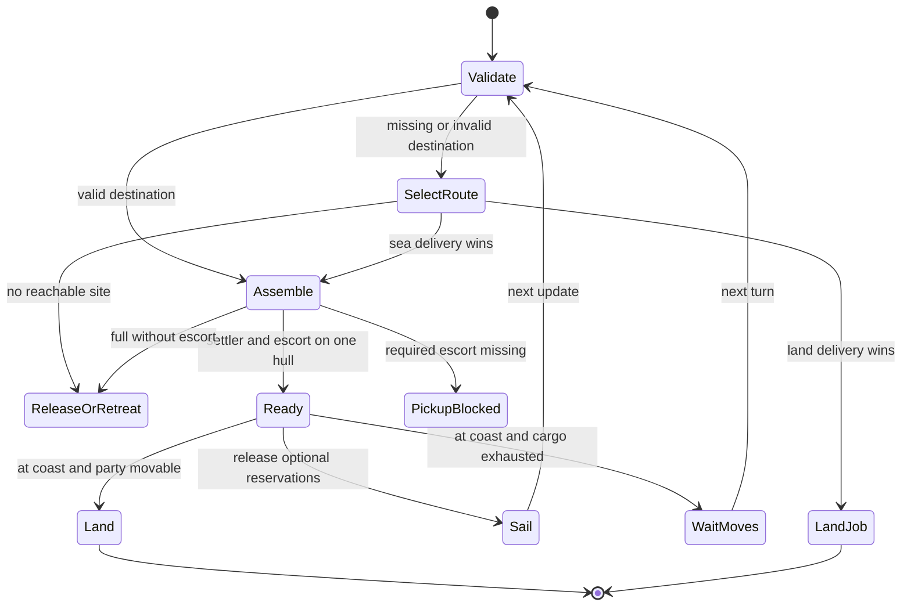

# Why settler ships idle, and the replacement dispatch algorithm

Base: GitLab `19e4d59e0a8fc5dc138de5108d8e921e95d28ba1` (2026-10-11).
That commit incorporates the earlier cleanup/resource/cargo/accounting runtime
fixes, with formatting differences, but omits their tests. This change restores
those regression checks and adds the opening and voyage work below. No save
layout, XML balance or bundled DLL changes are made.

[Apply the tested source patch](../../fixes/README.md#opening-development-and-settler-voyages).
The [manifest](../../fixes/voyages-manifest.json) pins every changed file and the
[regression log](../../fixes/voyages-regression.log) records the checks.
Runtime source is published as a patch here; it has not been pushed to GitLab.

The [scenario backlog](scenarios.json) distinguishes checks executed through
native fragments from the engine differential experiments still required.

## Why loaded transports can do nothing useful

The old settler transport controller does not own a delivery job. It asks a
series of independent questions, each able to replace the previous intention:

- A partly filled ship departs only with a `CITY_DEFENSE` passenger and **zero**
  inbound `LOAD_SETTLER` reservations. An attack/reserve unit that can defend is
  not recognized by that condition. Reservations include entire groups, have no
  deadline here, and are not limited to passengers needed by this voyage.
- An escort-only ship unloads at a friendly port. Cargo existence/fullness is
  sometimes counted for the whole selection group, sometimes for the head hull.
  A head with escorts can consequently unload a grouped follower's settler.
- Site selection compares the best same-area and other-area raw found values
  before computing sailing time. A better same-area site makes it unload; a
  four-move galley cannot win against a slow walk in that comparison.
- `canCargoAllMove()` gates the entire transport operation. Boarding calls
  `finishMoves()` on passengers, even though it does not exhaust the ship.
- Port retreat can run merely because local defensive strength is zero, with
  no enemy offensive strength at all.

Pinned upstream evidence: [departure rules](https://gitlab.com/aretemaxxing-group/rise-of-mankind/-/blob/19e4d59e0a8fc5dc138de5108d8e921e95d28ba1/Assets/CvGameCoreDLL/CvUnitAI.cpp#L7761),
[destination selection](https://gitlab.com/aretemaxxing-group/rise-of-mankind/-/blob/19e4d59e0a8fc5dc138de5108d8e921e95d28ba1/Assets/CvGameCoreDLL/CvUnitAI.cpp#L17855), [boarding](https://gitlab.com/aretemaxxing-group/rise-of-mankind/-/blob/19e4d59e0a8fc5dc138de5108d8e921e95d28ba1/Assets/CvGameCoreDLL/CvUnit.cpp#L12154),
and [amphibious landing](https://gitlab.com/aretemaxxing-group/rise-of-mankind/-/blob/19e4d59e0a8fc5dc138de5108d8e921e95d28ba1/Assets/CvGameCoreDLL/CvSelectionGroup.cpp#L4973).

These are source-backed failure mechanisms, not proof of the exact sequence
inside the supplied save. We cannot run that save in BTS in this environment.

## Implemented algorithm

Use a deterministic, per-voyage capacitated assignment followed by native path
queries. The required party is a settler plus an actual defending land unit on
one hull. Spare cargo capacity is optional. `MISSIONAI_FOUND` and its plot carry
the committed destination across updates using the existing serialized fields.

1. Detach loaded settler hulls from a civilian group at a friendly port. Give
   those hulls the settler-transport role and retain any founding destination.
2. Revalidate an existing destination. Keep it while legal, reachable and within
   the expansion horizon. This prevents rescoring from undoing a valid voyage.
3. Without a valid commitment, evaluate the existing city-site portfolio (2–6
   sites). Compare land delivery with sea delivery using the same
   `AISettlementPolicy::deliveryValue` used by land settlement. Sea delivery
   evaluates every adjacent water approach and includes one landing turn.
   Land handoff includes one unloading/coordination turn. Prefer land on ties.
4. If an escort is missing, first consider legal transfers from other idle
   transports at the same port, then unassigned individual shore troops or an
   explicit loading claimant for this ship. Respect explicit war/city jobs and
   other settlers'/workers' ships. Keep the landing party in one selection group.
5. A ready party releases surplus loading reservations and sails. Boarding does
   not force a whole turn of ship idleness. Landing waits until all passengers
   can move; the engine's amphibious-movement code performs the landing.
6. Record a concrete outcome in BBAI unit logs: `ASSIGNED_ESCORT`, `SAIL`, `LAND`,
   `LAND_JOB`, `WAIT_MOVES`, `MISSING_ESCORT_OR_CAPACITY`, or `NO_REACHABLE_SITE`.
   An invalid destination is replanned. No reachable site releases cargo at a
   friendly port, or attempts retreat at sea. An impossible full civilian-only
   manifest is released at port. A genuinely missing escort can still invoke
   the existing pickup mechanism; it is not treated as a ready voyage.

For a land party already at a friendly port, `AI_loadForSettlement` compares
available empty civilian/idle assault transports against walking to the chosen
coastal site. It loads the entire party only when it fits, every member can load,
and sailing plus a conservative two-turn transfer allowance beats walking.
This lets a same-landmass ferry win without requiring a different continent.

This is exact route selection over the evaluated approaches, using host path
answers, and deterministic greedy assignment of the available escort. It is
**not** globally optimal fleet scheduling. It does not yet search arbitrary
embarkation ports, inland destinations through intermediate beaches, or
multi-ship convoys. Empty-ship demand and distant pickup retain legacy logic.
Existing site utility is a heuristic, not a forecast of game-winning value.

## Cost and ownership

Let S be shortlisted sites (currently at most 6), U the units at the port, C
cargo size, G the player's selection groups, and P the cost of a host path query.
A new loaded voyage makes at most S land and 8S sea queries. Site reservation
checks scan G groups; cargo inspection scans the port; repeated donor cargo-count
queries make the escort scan O(U²). The conservative total is
O(S(P + G) + U² + G), plus host path workspace. The current
implementation favors auditability over a cached per-port cargo index; profile
large ports before introducing that cache. Continued voyages need at most eight
sea path queries plus validation and the claim scan. No full-map fallback search
is retained in this controller. The land-party shortcut is O(B (C + 8P + G)) for
B eligible boats because reservation checks scan the player's groups.

No RNG draws, background jobs, new save records, or global path pointers are
introduced. Copy the end-turn plot immediately after each query: the engine's
path result is shared and subsequent queries overwrite it. C++03 containers and
existing engine mission APIs implement the changes.

A future port-wide bipartite assignment could assign **indivisible parties** to
compatible ships. Minimum-cost matching is appropriate only after feasible
party/ship/route costs are constructed; varying cargo capacity and shared
escorts require additional constraints. A genetic algorithm is unnecessary for
these small, deterministic dispatch decisions. It could tune utility parameters
offline against held-out rollouts, but cannot repair missing mission ownership.

## Opening production

Actionable work boats and workers are considered before the first-garrison
branch. Zero guards, a desired defender quota, and a strategic turtle flag do
not block development. A local enemy strength estimate can still require an
immediate response. The estimate uses the existing distance/movement heuristic,
not an exact enemy arrival search. Existing water-danger and worker-demand
estimates remain inputs. This is an opening-priority correction, not yet a
joint economic/combat rollout optimizer.

## Validation and remaining engine work

`test_ai_opening_ferry.py` executes opening production and the complete ferry
selection method with narrow host adapters. `test_ai_settler_dispatch.py`
executes the complete dispatcher, water-approach helper, reservation release and
port group separation against explicit path/mission/unit adapters. It covers:

- no-guard opening work boat; inland worker; actual nearby attack response;
- fast ferry versus walking, transfer cost, unavailable/claimed ships;
- one settler plus four escorts split across two ships, with surplus requests;
- a non-city-defense escort, partially filled hull, and immediate sailing;
- delayed landing after boarding, retained destination, and invalidation;
- protected war/city assignments, another settler's escort, full manifest;
- unreachable sites, land handoff, and a follower hull hidden by its group head.

The checks compile production C++03 fragments with warnings as errors and fatal
UBSan. They do not execute host A*, engine turn scheduling, real boarding or
amphibious mission execution. Rebuild the DLL and replay autoplay before claiming
in-game success. Instrument source commit, cargo unit/transport IDs, mission type
and plot, movement remaining, candidate routes and transition result each turn.

Still unresolved: missing-escort pickup can wait or retry through legacy rules;
failed voyages have no persistent cooldown; port update order can change which
unassigned escort is available; the six-site portfolio may omit a good maritime
site; worker/export and assault-fleet demand are not unified with civilian jobs.
These are explicit next simulation targets rather than hidden claims that the
entire naval AI has been solved.
