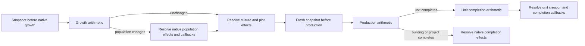

# Native city-economy arithmetic slice

This directory implements the first source-backed piece of the economic forecast: **growth stocks, production accrual, and unit-completion overflow/gold accounting**, with explicit stopping boundaries. It replaces guessed arithmetic with a C++03 value-type kernel. It does not yet choose production or simulate a whole city turn.

```sh
# Execute the supplied synthetic phase snapshots; no source checkout required.
python3 simulation/economy/run.py simulation/economy/examples.jsonl

# Compile actual source fragments and compare their results with the kernel.
python3 simulation/economy/test_economy.py --source /path/to/rise-of-mankind
```

Requires Python 3 and g++ with C++03/UBSan support; no Python packages. Builds use temporary directories. [Results](results.json) record compiler, input seeds and artifact hashes. The runner accepts JSONL with exactly `id`, `phase`, and `snapshot`; every snapshot field is required, and values must be signed 32-bit integers. [Examples](examples.jsonl) are controlled inputs, not exports from the Carthage save.

## Native phase boundaries

`CvCity::doTurn` runs AI/check-production, growth, culture/plot culture, then production. A single beginning-of-turn yield snapshot is insufficient. Population changes affect plot yield and maintenance, mark citizen assignment dirty and can mark AI production choice dirty. Building completion can change modifiers before its overflow accounting.



Only the three arithmetic nodes are implemented. `snapshot_adapter.h` supplies typed getter adapters for growth and production; it is compiled against the explicit test host, not linked into a rebuilt DLL. Capturing source getters in the real game and differential-checking full effects remains work. The caller must supply a fresh snapshot at the correct boundary; the JSON runner deliberately executes independent records and does not infer their chronological validity.

## Supported calculations

**Growth.** Uses actual food yield/consumption inputs, production-as-food behavior, the population-one floor, granary storage clamp, avoid-growth behavior, starvation and one population change per call. Disorder makes food difference zero; it does not prevent the native code from growing if stored food already reaches the threshold. Positive food surplus is not stored while producing a food-production unit, but a deficit can still cause starvation.

**Production.** Computes `(base production + overflow + feature production) * total modifier / 100`, then adds food production. Food production uses `foodConsumption(true)`, which excludes angry citizens and can differ from growth consumption. Surplus food is added **after** the production multiplier. Overflow/feature production is consumed once by an active build, preserved in disorder, and idle production is normalized back into base overflow using native rounding.

**Unit completion.** Caps excess production at `max(item cost, current production without overflow)`, removes the item's production modifier from carried overflow, and computes lost-production gold using the source's intermediate rounding order. It resets item production; the source oracle also verifies the decay timer resets to zero. This function is for unit orders only. Building completion changes the building state before computing overflow; applying the same snapshot blindly would be wrong.

The kernel treats captured yield rates, modifiers, thresholds, upkeep-related consumption and costs as inputs. It does not derive them from potential map yields or base XML. This is an intentional boundary: assigning every resource in a city's radius to nonexistent citizens would invalidate later optimization.

## Return contract

| Status | Meaning |
|---|---|
| `applied` | The supported phase arithmetic completed; this is not permission to skip other native phases |
| `population_effects_required` | Proposed food/population stock changes are known; resolve population effects and growth callbacks before continuing |
| `completion_effects_required` | Production reached the order cost; output is immediately before `popOrder` |
| `unit_creation_required` | Unit overflow/gold arithmetic is known; creation, experience, orders, upkeep and callbacks remain |
| `callback_unsupported` | An enabled native growth/production callback may own the phase; no speculative mutation |
| `production_choice_required` | Native production can reselect the order here; capture again after that choice |
| `process_unsupported` | Wealth/research/culture process effects and process-pop state are not modelled |
| `invalid_snapshot` | Fields violate the declared phase-input contract |
| `native_arithmetic_range` | A native signed-int intermediate would overflow; do not invent defined game behavior |

Unsupported/error results preserve input stocks. Boundary results expose only the listed arithmetic changes, not a fully committed game state. Effective callback settings must be captured at runtime; disabled base XML does not prove every mod configuration disables callbacks.

The kernel uses wide intermediates to detect overflow **before** clamping. It rejects values that would overflow the native 32-bit expression even if later division/clamping would hide that overflow. Windows uses `__int64`; the Linux test path uses g++'s `long long` support in C++03 mode. These checks do not establish the DLL ABI or whole-project Windows compilation.

## Verification

**12 tests pass**, including **15,000 seeded differential cases** and **23 named cases**. Six unchanged native methods and the unit-completion arithmetic block are compiled from the supplied source checkout. [The source contract](source_contract.json) pins normalized method hashes; a changed method forces review rather than silently updating expected results. These hashes were verified against GitLab `b8c379c` as well as the previously reviewed patched source.

The oracle's getters supply controlled values. Population effects and order completion throw explicit boundary signals; callbacks abort if reached unexpectedly. The unit-completion block stops before `initUnit`. The host therefore checks arithmetic and boundaries, not population allocation, unit spawning or Python behavior. Random inputs exercise the supported arithmetic domain; not every combination represents a reachable game city.

Named cases cover granary growth, starvation, avoid-growth, disorder, food-production units, integer rounding, overflow/chops, completion caps and gold. Additional tests check malformed input, native overflow, unsupported callbacks/processes, AI order reselection, source drift and stock sequences. A sequence verifies that normalized overflow contributes to the next build exactly once; another demonstrates why a population change requires refreshed production rates.

Each phase uses constant time and storage. No world traversal, allocation or RNG occurs inside the kernel. The Python CLI compiles and launches a process for reproducibility, not for online DLL use.

## Next integration boundary

1. Export phase snapshots and observed results from a matching DLL without replaying decision functions for logging.
2. Differential-check citizen allocation, growth effects and culture timing; compare predicted versus actual fresh rates.
3. Add effective improvement/worker completion and unit/building completion effects, maintenance and research.
4. Connect the verified transition model to the [project scheduler](../../research/competence/README.md), initially in shadow mode.

No new production policy, settlement evaluator or civic decision is enabled by this commit. The current [settler landing fix](../../research/landing/README.md) is a separate runtime correction.
