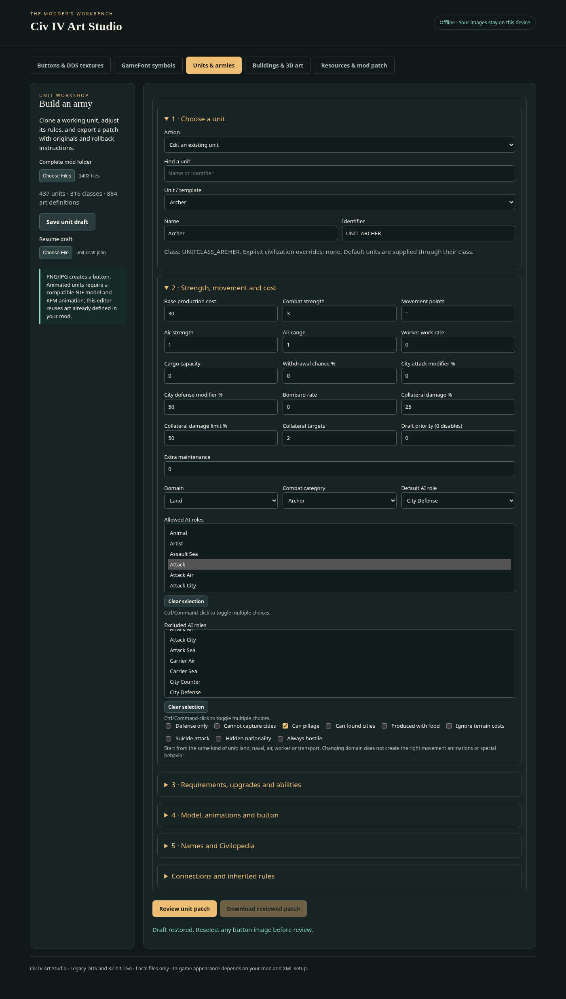

# Civ IV Art Studio

An offline workshop for **Civilization IV units, buildings, resources, DDS buttons and GameFont symbols**. No installation, Photoshop plugin, Python runtime or image upload is required to use the app.

[Download the ready-to-use ZIP](Civ4ArtStudio.zip?raw=true) · [Standalone HTML](dist/Civ4ArtStudio.html?raw=true)



## Start

1. Download and extract `Civ4ArtStudio.zip`.
2. Open `Civ4ArtStudio.html` in a current desktop Chrome, Edge or Firefox browser.
3. Choose a JPG or PNG. Select **Buttons & DDS textures** or **GameFont symbols**.

Everything runs on your device. Images are never sent to a server. Downloads are new files; the program does not write directly into your mod installation. The app and its source are MIT-licensed. It contains no game artwork.

## Unit workshop

Open **Units & armies** and select the complete mod folder (or reuse the folder loaded by another workshop). Search by name or identifier. The default template is Warrior; choose a template of the same kind as the intended unit, especially for aircraft, ships, workers, transports and special units.

- **Add:** create a separate unlimited unit class available to all civilizations, or a unique replacement within the template's class for selected civilizations. The review names any existing unique unit being replaced. Class-based upgrades resolve to each civilization's corresponding unit.
- **Edit:** change cost, land/air strength, movement, work rate, cargo capacity, withdrawal, city combat modifiers, bombard/collateral effects, draft priority and extra maintenance. Set AI roles, common flags, main/additional technologies, mandatory/alternative resources, city building/religion/corporation requirements, upgrades, free promotions and worker actions.
- **Disable normal recruitment:** sets production cost to -1. It preserves existing units and references. It does not remove existing units or prevent scripted creation; upgrade and event behavior still follows the game rules.
- **Remove:** deletes the unit definition and its exclusive class if unused. References to either ID elsewhere block removal. The Connections panel lists affected files. Shared art and text are retained. Resolve references externally and reload, or disable recruitment instead. No blind cascading deletion is performed.

Use the **Connections and inherited rules** panel before exporting. Civilian actions, cargo restrictions, combat/terrain modifiers, class limits on edits, other special prerequisites, sounds and unexposed settings remain inherited. New standalone classes reset template instance limits; unique replacements retain the existing class limits. Editing a unit does not change its class or civilization assignments. Python and compiled behavior tied to an original identifier is not transferred to a newly named clone.

**Art:** keep the template's mesh groups and early/middle/late era art, or select an existing art definition and change its scale/button. An art definition reuses its NIF, KFM, shader model, sounds and shadow together. Selecting an art source includes its module path to avoid guessing which definition was intended. A JPG/PNG becomes a 64px DDS button; it cannot become an animated soldier. Art replacement assigns the selected definition to all existing mesh groups and era slots, retaining group sizes and formation. For existing units, civilization style overrides are updated by default; unchecking this explicitly preserves them. New unit identifiers do not inherit style overrides keyed to the old identifier. Test movement, attacks and death animations in game: there is no animated model preview or rigging tool in this release.

Write names, Civilopedia and strategy in five language tabs. Missing translations fall back to English and appear in the review. Save/resume drafts; image files must be reselected. Changing a field invalidates the prior review.

**Export and install:** download a reviewed ZIP containing `patch/`, exact `backup/` originals, a checksummed manifest, draft and install/rollback instructions. No files in your mod are overwritten by the app. Apply to a copy of the exact loaded mod; compare checksums first and use a new game for structural changes. Test trainability, resource AND/OR logic, civilization availability, upgrades, promotions, artwork and AI behavior. Exported patches are not claimed to have been run in Civ IV.

Removal scans supplied XML, Python, C++/headers, INI/JSON and WorldBuilder files. It cannot inspect compiled DLL references, files outside the selected Assets tree or saves. Module activation/load order is not simulated; ambiguous unit/class definitions are blocked. Prerequisite array limits are checked against supplied GlobalDefines variants conservatively (the smallest declared limit), with conservative defaults if absent. Upgrade cycles returning to the edited class and contradictory AI-role selections are rejected.

### How units connect

`CIV4UnitInfos.xml` links the unit to its class, technologies, resources, buildings, promotions, AI roles, build actions and art mesh groups. `CIV4UnitClassInfos.xml` supplies a default unit and instance limits. `CIV4CivilizationInfos.xml` can replace that default per civilization. `CIV4UnitArtStyleTypeInfos.xml` can override models by unit ID and civilization art style. `CIV4ArtDefines_Unit.xml` connects each art type to NIF/KFM/shader assets, button and sound/shadow settings. GameText supplies localized names and descriptions.

Draft priority is the selection weight used by `CvCity::getConscriptUnit`, not a population cost. `CvCity::getConscriptPopulation` calculates that separately from production cost and `CONSCRIPT_POPULATION_PER_COST`.

Source tracing in this RoM checkout: `CvPlayer::canTrain` checks civilization mapping, cost and player-level prerequisites; `CvCity::isPlotTrainable` checks city building restrictions; `CvPlot::canTrain` handles plot/resource constraints; `CvUnitInfo::read` loads the prerequisite arrays using GlobalDefines capacities. Actual training and scripted spawning can have additional Python/option-dependent rules, so the editor preserves unexposed template fields and exposes the reference scan.

## Building workshop

Open **Buildings & 3D art** and select your complete mod folder. It shares the folder already loaded in the Resource workshop. The default template in Rise of Mankind is Library; use an ordinary building for ordinary construction, and inspect the **Inherited rules** panel before cloning a special building.

1. Choose **Create building** or **Edit building**, a template, and a display name. A new building gets its own building class and default-building link, rather than replacing an existing civilization's unique building.
2. Set ordinary/national/world/team limits, base production cost, technology, mandatory resource, and buildings required in the same city. Production cost is the unscaled XML value: Marathon applies its game-speed modifiers in game.
3. Set health, happiness, maintenance and defense, flat yields/commerce, and percentage modifiers. Schema-aware insertion puts optional arrays in the appropriate position. Unexposed requirements, empire-wide prerequisite counts, effects and flags stay inherited and are listed for review. Class-limit changes are blocked when they would also change civilization variants.
4. Choose an artwork route below. Art definitions with the same type in different modules are shown as explicit source choices. New art is cloned into its own unique definition; the editor does not guess module load order.
5. Choose a city footprint from your actual `Civ4CityLSystem.xml`, and tune city/Pedia scale. Generic footprints already in that file do not need new L-system entries.
6. Add an optional button image, Civilopedia and strategy text, and translations. Empty translations fall back to English and are reported.
7. Review and download a patch. It includes building XML, class XML when needed, art, text, generated assets, exact backups, checksums, draft and rollback instructions. Install only in a test copy of the same mod snapshot. Reload after installing before preparing another patch.

Buildings do not ordinarily need a GameFont slot. A new building's original template movie is cleared; special Python behavior tied to the old building identifier does not transfer automatically. The editor is not an arbitrary schema editor, full dependency solver or save migration tool.

### Building artwork routes

| What you have | Route | What it produces |
| --- | --- | --- |
| Existing Civ IV building art | Reuse existing model | New art definition referencing the working model, textures and animation |
| PNG/JPEG façade or surface image | Simple box building | Actual static NIF geometry, a diffuse DDS with mipmaps, UV mapping and optional preview-derived button |
| Triangulated OBJ and one texture atlas | Architectural OBJ | Static NIF with positions, normals, UVs, bounds, material and linked diffuse DDS |
| BLEND, FBX, GLB/GLTF or multi-material OBJ | Prepare in Blender first | Triangulated OBJ and a single baked PNG atlas for the browser route |
| CAD, plans or an ordinary photograph | Model/tessellate first, or use the box route | No automatic reconstruction of a detailed building from a photograph or floor plan |

**An image does not describe geometry.** The box is a simple six-sided structure, with the image repeated on four walls and a solid-color roof. It is useful for placeholders and simple buildings, not architectural reconstruction. Existing NIF reuse keeps the original texture assignments; this release does not retarget arbitrary NIF materials.

The OBJ route accepts a single material and requires UV coordinates and triangle faces. It supports negative indices and supplied normals; otherwise it computes face normals. Z-up and Y-up imports and V flipping are explicit controls. Meshes are centered, grounded and normalized to a two-unit horizontal span. Limits: 20 MB OBJ, 20,000 triangles, and fewer than 65,536 exported vertices. OBJ polygons, missing UVs, out-of-range indices, degenerate triangles and multiple materials are rejected rather than silently flattened.

Generated models use standard **Gamebryo NIF 20.0.0.4** with a static mesh and one opaque diffuse material. OBJ texture images are stretched to a square 256/512/1024 atlas without cropping; the box route reserves one quarter of its atlas for the solid roof, encoded as DXT3 with a full mip chain, and linked by an explicit game-relative path. Transparent input pixels are composited over the chosen background. This route does not export animation, skinning, collision, PBR, normal maps, specular/glow maps or alpha-cutout materials. Preserve source images and project files for future edits.

The WebGL preview lets you rotate the mesh and inspect a UV overlay. With no separate button image, its current view is rendered into a 64×64 DDS button. Model generation needs WebGL; model reuse and ordinary image conversion do not. Browser preview lighting is not Civ IV lighting. New-model ZIPs are labelled **MODEL-TEST**: test in-game city and Pedia rendering, scale, UV orientation, different eras/art styles, requirements and effects before deployment.

### Prepare architecture in Blender

The downloadable ZIP includes `helpers/prepare_building.py`. Install **Blender 4.x** only if you need this optional preparation step. Run from a terminal, quoting your paths:

```sh
blender --background --python-exit-code 1 --python helpers/prepare_building.py -- "my-building.glb" "prepared-building" --size 512 --triangles 8000
```

Use an empty output directory. The helper reads BLEND, FBX, GLB, GLTF or OBJ, evaluates visible mesh geometry, joins it, simplifies when necessary, triangulates, creates a new UV atlas, and bakes unlit base color to PNG. It exports `building.obj`, `diffuse.png` and `preparation.json`. Source project files are never saved; embedded Blender scripts are disabled when loading a BLEND file. Load the OBJ with **Z up** and the PNG as the diffuse texture in the app.

The helper supports Principled, Diffuse and Emission surface shaders. Mix/group/custom surface graphs require manual baking; geometry, instances and procedural mapping should always be inspected after conversion. It does not interpret CAD or invent geometry from a photograph. Remove interiors and unseen details before processing; decimation is a polygon reduction, not architectural understanding. Open the source in Blender and bake manually when its material setup falls outside these limits.

## Resource workshop

Open **Resources & mod patch**, then choose your mod folder (the folder containing `Assets`, or `Assets` itself). The browser may call folder selection an “upload”; this app reads it locally and makes no network requests.

1. Choose **Create a new resource** or **Edit an existing resource**, and select a template. Bauxite is a useful mined-deposit template in Rise of Mankind.
2. Enter a name. New internal identifiers are generated automatically. Existing identifiers stay fixed.
3. Set discovery/trade/obsolete technologies, health, happiness, tile yields, terrain and placement weight. Unexposed rules remain inherited from the template: the form explains latitude, feature and random-placement inheritance.
4. Select connecting improvements, producer buildings, and mandatory unit/building consumers. Existing alternative requirements remain unchanged. Multiple selections use Ctrl/Cmd-click. Existing connections retain their yields; new connections copy the template's improvement entry when available.
5. Choose an existing resource's map model. Optionally load a PNG/JPG for a new 64×64 DXT3 button. Model textures and animations remain in your mod; this tool does not create NIFs.
6. Write the Civilopedia description and optional translations. Missing French/German/Italian/Spanish strings fall back to English, explicitly reported in the patch notes.
7. **Review patch**, then **Download reviewed patch**. Any form change invalidates the review.

The ZIP contains `patch/Assets/...`, exact original-file backups, a SHA256 manifest, a reusable draft and installation/rollback instructions. Copy the **contents of patch/** into a test copy of the mod. Nothing writes into the selected installation. Create one resource per patch, install/test it, then reload the updated folder before producing another patch. Drafts save settings but not artwork; reselect the image after reopening a draft.

Natural resources keep the template's map-generation behavior except for the controls you change. Manufactured resources disable natural placement and require a producer building. The producer uses `FreeBonus` and `iNumFreeBonuses`; this is not an automatic input/output conversion chain. Buildings already producing another resource cannot be reassigned here. Corporation inputs, special Python rules, advanced building modifiers, arbitrary schema editing and save-game migration are outside the form.

### Resource GameFont choices

**Reuse existing symbol** is the default and works without editing either font. A new resource can use its own button/model while sharing an existing text symbol.

**Custom GameFont slot** presents enlarged cells from both sheets. Enter the intended resource index and select matching empty cells independently. The editor checks every resource art definition it finds, including modules, and blocks occupied indices and cells with visible artwork. It protects markers and checks both exported TGAs pixel by pixel. An unreferenced number does **not** prove an unused or valid glyph allocation.

Without an in-game-verified mapping, the ZIP is labelled **TEST ONLY**. Test that resource at both font sizes, plus existing health/happiness/trade and other symbols. Mark the mapping verified only after that check. Draft import deliberately clears verification because the loaded font/DLL may have changed. The editor never infers an index by counting visual cells, expands the font grid, or rewrites DLL offsets. Module load order is not inferred: ambiguous duplicate definitions are blocked, and inactive modules still participate in collision checks.

This is a template editor with structural and reference checks, not a full Civ IV schema validator or a game simulator. Restart the game and use a new map to test additions. Mod-specific map scripts may control placement separately. No in-game test has been performed in this environment.

## Make a button

- Choose **64 × 64 — button** for a standard icon.
- Use **Fit entire image**, **Fill & crop**, or **Stretch to fit**. Crop focus controls choose which part stays visible; inset adds breathing room.
- Transparent PNG is best for cutout artwork. For a plain JPG background, enable **Remove a background color** and choose its color and tolerance. This is color keying, not automatic subject detection: matching colors inside the subject are also removed.
- Rounded corners, a solid background and a subtle gold border are optional.
- Export **DXT3 DDS** for compact files or **RGBA DDS** for lossless 8-bit alpha and color. DXT3 uses 4-bit alpha and lossy color compression. The preview shows your prepared artwork before DDS compression.
- Leave mipmaps off for a typical UI button. Turn them on when the specific texture needs them. General textures support square presets or custom power-of-two dimensions from 4 through 2048.

Place the result under your mod, for example:

```text
Assets/Art/Interface/Buttons/Custom/my_button.dds
```

The app provides a direct Button XML value:

```xml
<Button>Art/Interface/Buttons/Custom/my_button.dds</Button>
```

Use the appropriate object or ArtDefine entry. This is a standalone button, not an atlas reference. For model textures, existing NIF material/UV assignments still determine where the image appears; the converter does not make or alter those assignments.

## Make a GameFont symbol

A GameFont sheet is **not** a regular resized image. It contains glyph cells, transparent RGB data and marker pixels that Civ IV uses to find symbols. Work from your mod's existing files:

```text
Assets/res/Fonts/GameFont.tga
Assets/res/Fonts/GameFont_75.tga
```

1. Back up both originals outside the mod folder.
2. Open **GameFont symbols** and load the original full-size TGA.
3. Click the cell already assigned to the symbol you are replacing. You can also use its visual row and column. **Reveal grid & markers** shows the RGB colors stored beneath transparency; uncheck it to view the normal artwork.
4. Adjust the artwork, then click **Apply artwork to selected cell**. Undo is available for each sheet.
5. Load the small font and select its matching symbol **independently**. Its cell size and location can differ. Apply the artwork there too.
6. Download an edited TGA individually, or download both edited sheets and their JSON edit log as a ZIP.
7. Put the edited files in the mod's `Assets/res/Fonts` directory and inspect the relevant symbol in game at both font sizes.

Visual row and column are navigation labels, **not `FontButtonIndex` or Unicode values**. The standalone GameFont tab replaces existing cells and does not create new glyph allocations or rewrite XML. The separate Resource workshop creates matching resource XML and supports explicitly mapped empty slots. Adding a new game object still requires the mod's own index and XML setup. Do not infer a game index from the displayed cell number.

### Font protection

- Detects cells from complete magenta/cyan divider rows and columns; rejects sheets without a detectable grid.
- Requires a true-color 32-bit TGA declaring 8 alpha bits. Uncompressed and RLE input are supported; output is uncompressed 32-bit TGA.
- Preserves dimensions, glyph positions and all original marker pixels, including markers inside a selected cell.
- Avoids introducing exact magenta or cyan marker colors into new artwork by changing the blue component by one level when necessary.
- Before export, checks every pixel outside edited rectangles and every original marker pixel against the original buffer.
- Decodes the exported file again and verifies that all RGBA bytes match the edited buffer.
- Retains the header, image ID and trailing metadata for standard uncompressed 32-bit input. RLE input is decoded and written as uncompressed TGA; optional trailing RLE metadata is not carried over because its byte offsets may no longer be valid.

If the grid cannot be detected reliably, use an intact original sheet. This version has no manual grid rebuilding mode. It does not rebuild the font grid or generate button atlases.

## Limits and validation

Artwork input is limited to 50 MB and 40 megapixels; a working copy is reduced to a maximum side of 2048 pixels. GameFont input is limited to 80 MB and 16 megapixels. Normal JPEG and PNG formats, including transparent PNG, are decoded by the browser. Broken or unsupported files produce an error.

The app was tested in Chromium with JPG/PNG loading, background keying, DDS and PNG downloads, custom dimensions, GameFont selection, undo and paired font export. An independent Pillow decoder checked DDS colors, alpha and orientation; it also checked both actual Rise of Mankind font files pixel by pixel. No original files were overwritten. No external requests occurred during the browser workflow.

In-game rendering has not been tested. File structure and preservation tests do not verify that you selected the correct semantic symbol or that your mod's XML points to the right artwork. Browser testing in this managed environment used a local HTTP server because its policy restricts `file:` URLs; the standalone file has all scripts embedded and needs no network resources. If your browser disallows local HTML or local workers, serve the folder with a local static server and open it on localhost.

## Source and tests

`app/` holds the readable HTML, UI script and binary-format implementation. `build.py` embeds the scripts into `dist/Civ4ArtStudio.html`. There are no third-party runtime dependencies.

Developer checks require Node.js, Python with Pillow, and optionally Playwright with Chromium:

```sh
python build.py
node tests/test_core.js /path/to/mod/Assets/res/Fonts
python tests/check_formats.py /path/to/mod/Assets/res/Fonts
python tests/browser_check.py /path/to/mod/Assets/res/Fonts
python tests/resource_check.py /path/to/rise-of-mankind
node tests/test_mesh.js
python tests/building_check.py /path/to/rise-of-mankind
# Optional independent model validation, after installing PyFFI 2.2.3:
python tests/validate_nif.py
```

The core tests also run without the optional font-directory argument. The resource integration test expects the Rise of Mankind definitions (including Bauxite and Guilds). It copies inputs to ignored test fixtures, generates and inspects patches, and never modifies the supplied mod. Browser tests currently expect the Rise of Mankind font layout (1,301 / 1,325 detected cells). Synthetic fixtures and test outputs are generated under `tests/output/`; game files are read only and are not bundled.

The mod conventions were checked against Rise of Mankind source `2a8b9a83`: existing 64×64 DDS buttons use DXT3 among other formats; `CvGameTextMgr.cpp` assigns game font symbols using category counts and resource `FontButtonIndex`, and `CvBonusInfo::setChar` adds 125 in this mod, confirming that a visual cell position alone is not a sufficient game index.

Building validation includes real mod XML/class/art linking, schema order, wonder limits, backup integrity, OBJ error cases, generated DDS decoding, and repeated edits. NIF output is also checked independently with PyFFI 2.2.3 (a development-only dependency), and the Blender helper was exercised with a synthetic two-material scene in Blender 4.3.2. These checks are not an in-game rendering test.
